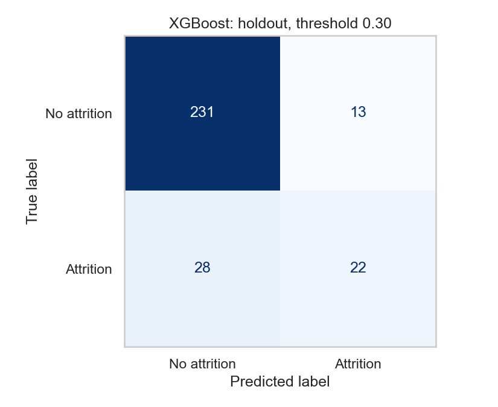
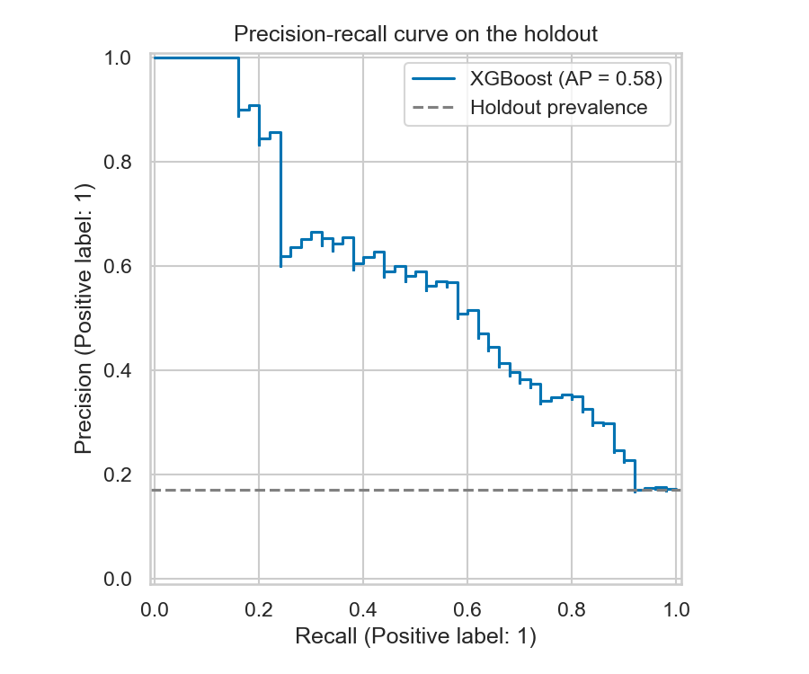
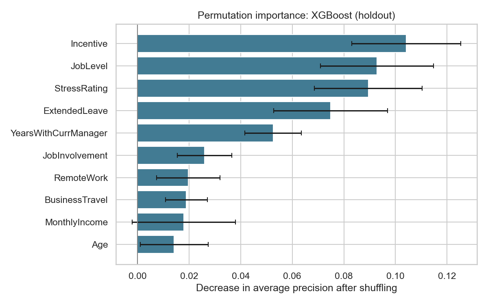

# Employee Attrition Prediction

A student data science project developed for **GCI Global 2025**, organised by the Matsuo-Iwasawa Laboratory at The University of Tokyo. It uses a course-modified IBM HR dataset to explore attrition patterns and compare classification models.

The main question is whether a small set of models can identify attrition cases more usefully than a majority-class baseline. The project covers data checks, exploratory analysis, feature engineering, validation, and interpretation.

**[Read the executed notebook](OmniCampus25UGM_FarhanAP.ipynb)** · **[View the result tables](results/)**

## Data and scope

The supplied CSV contains **1,470 rows and 44 columns**, including the `Attrition` target (`Yes`/`No`). There are 238 positive labels, no missing cells, and no completely duplicate rows. Some employee identifiers repeat across the two supplied year labels.

The dataset includes course-specific fields and modifications. Their complete provenance and the attrition prediction horizon are not documented here. This is a teaching case study; it should not be described as a verified sample of IBM's current workforce. The existing code license does not establish a separate license for the course-supplied data.

## Approach

1. **Set aside the 2024-labelled rows.** Use 2023-labelled rows for development. Exclude 28 earlier-year rows whose employee IDs appear in the holdout, leaving **1,148 development rows** and **294 holdout rows** with no shared IDs.
2. **Explore development data.** Examine class balance, department rates, selected distributions, and correlations. Show group sizes alongside rates.
3. **Build a preprocessing pipeline.** Exclude identifiers, year, and constant columns; create four row-level ratio/interaction features; impute, scale, and one-hot encode inside each training fold.
4. **Compare models on five fixed stratified folds.** Evaluate a dummy baseline, logistic regression, random forest, and XGBoost. Select by mean **average precision (AP)**, with ROC AUC and classification metrics as supporting measures.
5. **Choose a threshold on development predictions.** Select the highest-F1 threshold from a fixed grid using out-of-fold predictions, then fit the selected model on all development rows.
6. **Evaluate and interpret.** Report holdout metrics, errors, ROC and precision-recall curves, and permutation importance. No model or threshold changes are made from the holdout results.

The year-based split is a conservative exercise using the supplied labels, not proof of a real prospective evaluation. Earlier versions of this project already examined the dataset, so these results are not independent external validation.

## Results

The checked-in outputs were generated with Python 3.13.3 and the versions in [requirements.txt](requirements.txt). The exact dataset hash, split sizes, environment, and selected settings are recorded in [summary.json](results/summary.json).

### Development cross-validation

Mean and sample standard deviation across five folds. F1 uses a 0.50 threshold in this table.

| Model | Average precision | ROC AUC | F1 |
|---|---:|---:|---:|
| XGBoost | 0.6197 ± 0.0911 | 0.8413 ± 0.0457 | 0.4400 ± 0.0626 |
| Logistic regression | 0.5934 ± 0.0308 | 0.8350 ± 0.0363 | 0.5148 ± 0.0554 |
| Random forest | 0.5674 ± 0.1219 | 0.8081 ± 0.0399 | 0.5345 ± 0.1241 |
| Dummy baseline | 0.1638 ± 0.0020 | 0.5000 ± 0.0000 | 0.0000 ± 0.0000 |

XGBoost had the highest mean AP under this selection rule. The fold variability does not establish that it is generally superior to the other models. The development-selected threshold was **0.30**.

### Holdout evaluation

The holdout contains 50 attrition cases among 294 rows. Both XGBoost rows use the same fitted model and ranking scores; only the classification threshold changes.

| Setting | AP | ROC AUC | Accuracy | Precision | Recall | F1 |
|---|---:|---:|---:|---:|---:|---:|
| Dummy at 0.50 | 0.1701 | 0.5000 | 0.8299 | 0.0000 | 0.0000 | 0.0000 |
| XGBoost at 0.50 | 0.5791 | 0.8034 | 0.8605 | 0.8000 | 0.2400 | 0.3692 |
| XGBoost at selected 0.30 | 0.5791 | 0.8034 | 0.8605 | 0.6286 | 0.4400 | 0.5176 |

At the selected threshold, the model identifies **22 of 50 attrition cases**, misses **28**, and incorrectly flags **13** non-attrition cases. The baseline's 82.99% accuracy illustrates why accuracy alone is insufficient. These scores use a different split and procedure from the original submission and should not be treated as a direct before/after improvement.





## Interpretation and limitations

In this run, shuffling `Incentive`, `JobLevel`, and `StressRating` produced the largest mean decreases in holdout AP. This describes the fitted model's dependence on these inputs. It does not establish causal effects, the direction of an effect, or the benefit of changing an employee's circumstances.



The small, modified dataset limits generalisation. Feature availability at prediction time needs to be established, and repeated IDs and year labels need a clearer data dictionary. The scores are not calibrated, the F1 threshold is not based on observed intervention costs, and subgroup fairness has not been validated. Additional data and a separate intervention study would be needed to support real retention decisions.

## Run the notebook

Use Python 3.11-3.13; the saved results were tested on 3.13.3. From the repository folder:

```powershell
python -m venv .venv
.venv\Scripts\Activate.ps1
python -m pip install -r requirements.txt
python scripts/run_notebook.py
```

On macOS/Linux, activate the environment with `source .venv/bin/activate` instead. The runner starts a fresh kernel, executes all 16 code cells, checks for errors, and saves the executed notebook only after successful execution. It also regenerates `assets/` and `results/`. Runtime caches stay in the ignored `.cache/` folder.

For interactive work, open the notebook in VS Code with the Python/Jupyter extensions, or install Jupyter Notebook with `python -m pip install notebook` and start it with `python -m notebook`. Select the project environment, restart the kernel, and run all cells.

For Colab, upload the CSV alongside the notebook. Alternatively, clone this repository in a setup cell, change into its folder, and install `requirements.txt`. No personal Google Drive path is required.

The notebook includes checks for disjoint employee IDs, ordered year labels, excluded target/identifier predictors, training-only scaler statistics, unseen-category handling, and an unchanged source CSV. Dependency versions or numerical libraries can affect results; the exported environment makes the saved run traceable. If you change the analysis, update this README from the regenerated result tables.

## Files

| File or folder | Purpose |
|---|---|
| [OmniCampus25UGM_FarhanAP.ipynb](OmniCampus25UGM_FarhanAP.ipynb) | Current analysis, explanations, executed outputs, and checks |
| [data._finalprojectcsv.csv](data._finalprojectcsv.csv) | Original course-supplied CSV; unchanged by the analysis |
| [requirements.txt](requirements.txt) | Direct dependencies used for the saved run |
| [scripts/run_notebook.py](scripts/run_notebook.py) | Run the analysis from a fresh kernel |
| [results/](results/) | CV scores, thresholds, holdout metrics, permutation importance, and run metadata |
| [assets/](assets/) | Figures regenerated by the notebook |
| [OmniCampus25UGM_FarhanAP.pdf](OmniCampus25UGM_FarhanAP.pdf) | Original submitted slides, retained as a historical artifact; they describe the earlier analysis |

## Revision notes and references

The revision fixes the missing import and environment assumptions, moves preprocessing inside validation, replaces label encoding of nominal inputs with one-hot encoding, and adds an explicit baseline. The comparison uses random forest in place of LightGBM to keep a small set of distinct model families. The prose and conclusions now describe what the code actually computes.

AI assistance was used to revise the code and explanations. All current tables and figures were generated by executing the notebook.

- GCI Global 2025 course materials and modified HR dataset, Matsuo-Iwasawa Laboratory, The University of Tokyo.
- scikit-learn: [data leakage and common pitfalls](https://scikit-learn.org/stable/common_pitfalls.html), [model evaluation](https://scikit-learn.org/stable/modules/model_evaluation.html), and [permutation importance](https://scikit-learn.org/stable/modules/permutation_importance.html).
- [XGBoost Python API](https://xgboost.readthedocs.io/en/stable/python/python_api.html).
